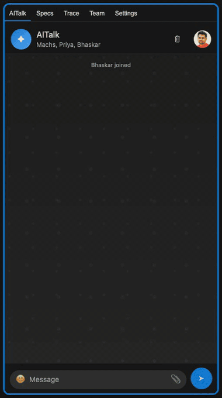
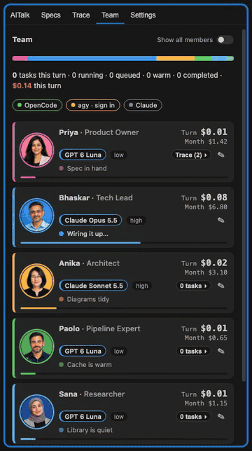
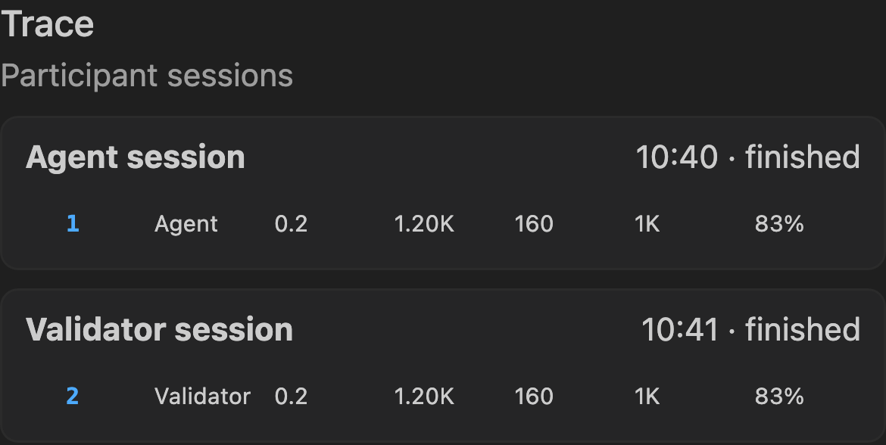
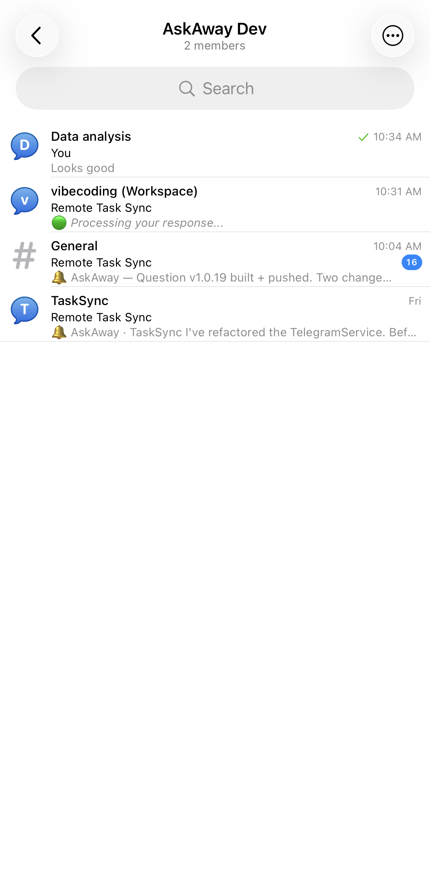

# AskAway

### Tell your AI what you want. Walk away. It keeps working and keeps you in the loop.

AskAway turns GitHub Copilot Chat into a small team. You describe the work in plain words. AskAway plans it with Spec Kit, hands the detail to background workers, and reports back in one chat room. You see what every turn costs. You can answer from your phone.



---

## Why AskAway

| You want to | AskAway gives you |
|---|---|
| Stop writing specs by hand | **Spec-based development.** Say what you need. AskAway runs specify, clarify, plan, tasks, implement and check. You only answer questions and approve three gates: what, how, done. |
| Keep the main chat short and cheap | **Background workers.** Detail work goes to parallel [OpenCode](https://opencode.ai) workers. Their cost and live session sit in one place. |
| Talk to your agents like a team | **AITalk.** A group chat per workspace with you, the main agent, the Validator and the workers. `@mention`, reply, react. Sent, delivered and read ticks. |
| Leave your desk without stopping the work | **Telegram and Webex.** Questions, status and final answers reach your phone. Reply from anywhere. |
| Know where the money goes | **Cost and trace.** Live cost per turn and per month, tokens, cache hits, and a trace of every request and tool call. |

---

## Meet the team

Every member is a named card in the **Team** tab: face, role, model, thinking level, turn cost, month cost and live tasks. Change a model or a name in one panel. Your choices stay on your machine.



- **Bhaskar**, the main agent, plans and decides.
- **Priya**, the Validator, remembers your past answers and predicts what you would decide. With live mode on and you away, she answers low-risk questions for you and holds the rest.
- **Cathy** handles Webex. She drafts every message as a card. Nothing is sent until you 👍 it.
- **Anika, Diego, Tara** and other workers take detail tasks and run in parallel. Add your own members with a profile file.

---

## Features

**Spec-based development.** The **Specs** tab shows the stage, user stories and tasks. Plain text works, or use `/sk-start`, `/sk-plan`, `/sk-tasks`, `/sk-check`, `/sk-continue` and `/sk-handoff`. New asks become tasks, so nothing is dropped. Questions come in one batch.

**Copy Handoff Prompt.** Five choices from the chat's own log: your messages and final replies, a tool digest saying what each call did, let a model choose, **Everything said, from the first message**, or the saved handoff. The new choice keeps all your messages and the agent's final replies (no tool calls), rebuilding earlier conversations behind a pasted handoff. Every choice includes worker requests and reports.

**Workers.** Reused and kept warm with cheap keep-alive pings, so their context is not rebuilt. Look inside a running worker, nudge it, or ask a side question without derailing the main agent. Runs on OpenCode, agy or Claude. The main agent waits for running workers. Team shows **+N finished** for recent paid tasks; an optional reviewer-only **Admin** tab brings worker history across workspaces together. **AskAway: Reconnect Worker MCP Servers** reconnects a failed server or opens its login only when you ask; automatic reconnect is off by default to avoid repeated Okta prompts.

**AITalk.** Edit or delete a message the agent has not read yet. Headings, lists, quotes, code, tables and links render safely as markdown in bubbles and **Show more**. Pick your availability from your avatar. A **Keep alive** switch sends a gentle ping before the prompt cache cools. Unread count, sound and a clear-chat button included.

**Cost, trace and timers.** A banner on every tab shows last input, turn output, cache hit, turn timer, cache age and worker spend. The trace flags cache misses, slow tool calls and oversized tool output. An efficiency score tells you when a turn was wasteful. Set a soft per-turn budget with `askaway.turnBudgetAiu`.



**Built-in tools for your agents.** `worker`, `gradle`, `code_nav`, `rg_search`, `read_doc`, `turn_budget`, `aitalk`, plus memory and validator tools. If [`rtk`](https://github.com/rtk-ai/rtk) is installed, its token savings show next to your metrics.

**Everyday helpers.** Smart queue, `#` file and folder references, image paste and drag-and-drop, reusable `/slash` prompts, tool-call history and an MCP server.

---

## Get started

1. Install AskAway from the Marketplace.
2. Open **AskAway** in the Activity Bar. **AITalk** is the first tab.
3. Type what you need. That is it.
4. Optional: install [OpenCode](https://opencode.ai) for workers, and connect Telegram or Webex.

Workers need OpenCode and at least one worker profile. See the [Workers setup guide](docs/WORKERS_SETUP.md).

### Telegram

1. Create a bot with [@BotFather](https://t.me/BotFather) and copy the token.
2. For one topic per workspace, create a group, enable **Topics**, add the bot and make it admin. For direct messages, just message the bot.
3. Run **AskAway: Get Telegram Chat ID**.
4. Set `askaway.telegram.enabled`, `askaway.telegram.botToken` and `askaway.telegram.chatId`.



### Webex

1. Turn on `askaway.webex.enabled`.
2. Run **AskAway: Set Webex Token** or **AskAway: Authorize Webex (OAuth)**. Tokens stay in VS Code secret storage.
3. Run **AskAway: Discover Webex Spaces** and **AskAway: Configure Webex Notifications**.

Replies are polled, so your laptop is never exposed to the internet.

### Other MCP clients

AskAway registers itself with Kiro and Cursor. For other clients:

```json
{
  "mcpServers": {
    "askaway": {
      "transport": "sse",
      "url": "http://localhost:3579/sse"
    }
  }
}
```

---

## Requirements

- VS Code 1.90 or newer
- GitHub Copilot Chat
- Optional: OpenCode (workers), Spec Kit, a Telegram bot or Webex account, `rtk`

If another extension registers the same tool names, disable it so only one is active.

## Support and feedback

Found a bug or want a feature? [Open an issue](https://github.com/intuitiv/AskAway/issues). The repository holds the documentation and the issue tracker. The source code is closed.

## License

MIT. See the license file in the extension package.
