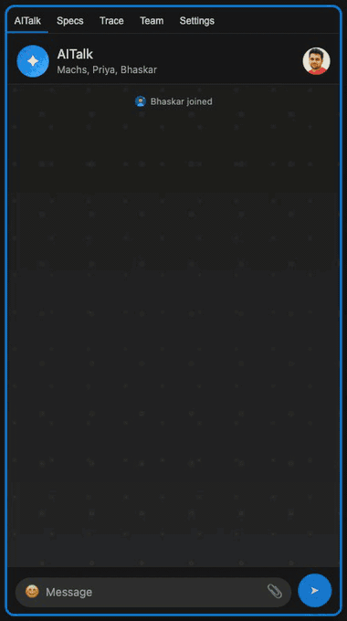
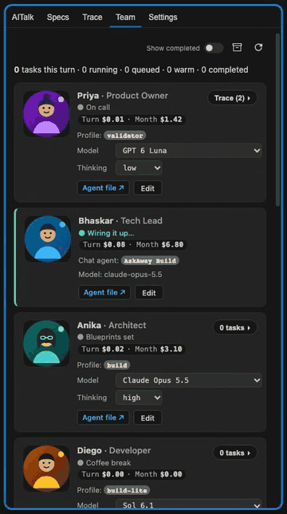
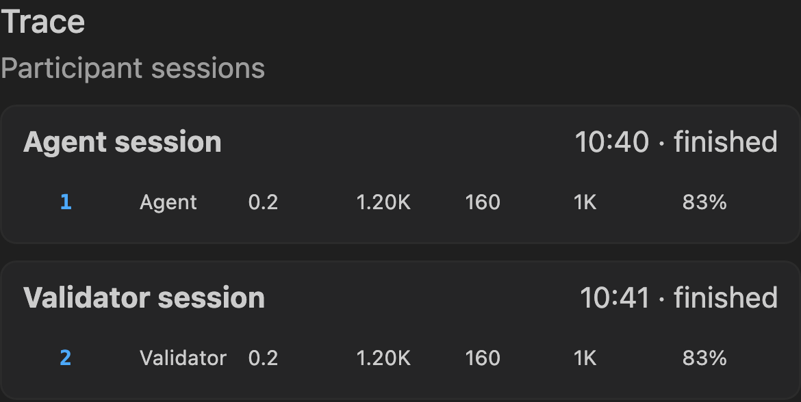

<p align="center">
  
</p>

<h1 align="center">AskAway</h1>

<p align="center">
  <strong>Spec-based development, OpenCode workers, an AITalk room, and Telegram / Webex remote control.</strong><br/>
  <sub>Dictate what you need; AskAway runs it through Spec Kit, delegates the detail to parallel workers, keeps you informed in one room, and shows what it costs.</sub>
</p>

<p align="center">
  <a href="https://marketplace.visualstudio.com/items?itemName=intuitiv.askaway"></a>
  <a href="https://marketplace.visualstudio.com/items?itemName=intuitiv.askaway"></a>
  <a href="https://github.com/intuitiv/TaskSync/blob/main/LICENSE"></a>
  <a href="https://github.com/intuitiv/TaskSync/stargazers"></a>
</p>

<p align="center">
  <a href="#what-askaway-does">What it does</a> -
  <a href="#aitalk-room">AITalk</a> -
  <a href="#spec-based-development">Specs</a> -
  <a href="#opencode-workers">Workers</a> -
  <a href="#telegram-and-webex">Remote</a> -
  <a href="#metrics-dashboard">Metrics</a> -
  <a href="#live-turn-trace">This Turn</a> -
  <a href="#optimization-tools">Tools</a> -
  <a href="#rtk-integration">RTK</a> -
  <a href="#installation">Install</a>
</p>

---

## What AskAway Does

**Your team, by name.** The Team tab shows one compact card per member: a face portrait (initials when there is none), name and full role, model and thinking chips, Turn cost with Month cost under it (agy shows $0.00), a status line that rotates every 8 seconds, and a Trace or tasks button. One pencil Edit button opens a single panel with name, role, picture, Model and Thinking dropdowns, the Agent file link (Priya's lives in `~/.askaway/validator/validator.md`) and Reset model to default; your choices are kept in `~/.askaway/team/`, never in the package. Priya (the Validator) shows first, then the main agent, then members by Turn spend; members with no spend appear when you switch on **Show all members** (off after every reload). OpenCode, agy and Claude health chips and a share bar of the turn sit above the cards. Your availability and Team settings are the same in every workspace, and a member's model and thinking are one choice shared by all of them. Build has two members, an Architect on Sonnet or Argon and a Developer on Sol. The main agent's progress lines also appear in AITalk.

**Members of your own.** Add `member:` and `role:` to a profile in `~/.askaway/worker-profiles/` and Team shows them, for example a rules-authoring expert. They stay out of the extension itself.

**Runtimes.** Settings → Integrations lists OpenCode, agy and Claude, each with an on/off switch, one Refresh button (OpenCode restarts its server after asking) and when it was last checked. OpenCode and agy start on. Claude runs workers through the `claude` CLI (`claude/sonnet`, `claude/opus`, `claude/haiku`) and reports its real cost. agy runs the `agy/gemini-4-argon-high` family; agy reports no cost, so its tasks show $0 rather than a price. At startup, every morning and on Refresh, each enabled integration's models are discovered and stored, and the Team dropdowns offer them. A signed-out agy or Claude shows a Sign in button that opens the login in a terminal. agy and Claude workers behave like OpenCode ones: each is identified by a carrier the model cannot set (agy's conversation id, a per-run Claude header), so your AITalk messages reach them on their next tool call and they can ask questions through the `aitalk` tool (`say` for room messages, `post` for feed lines); a Claude worker can be forked for fan-out; and agy and Claude conversations open in a terminal with Open in terminal.

**Your picture.** AITalk reads `~/.askaway/profile/avatar.png` by default, supports an explicit photo override, and falls back to initials. The photo is never copied into a workspace.

You tell the agent what you need. AskAway turns that into a flow you do not have to manage:

| Pillar | What you get |
|--------|--------------|
| **Spec-based development** | Plain-text requests are routed through Spec Kit (specify, clarify, plan, tasks, implement, check). The **Specs** tab shows the stage, user stories and tasks. You answer one batch of questions and approve three gates: what, how, done. |
| **OpenCode workers** | Detail work is delegated to reusable [OpenCode](https://opencode.ai) workers that run in parallel, so the main conversation stays short and cheap. |
| **AITalk room** | A WhatsApp-style group chat per workspace for you, the Agent, the Validator and the workers, with `@mentions`, replies, reactions, ticks and presence. |
| **Telegram and Webex** | Monitor everything from your phone and reply from there. Webex drafts need your approval in AITalk before they are sent. |
| **Cost, trace and timers** | Live per-turn and monthly cost, tokens, cache, worker share, efficiency score, keep-alive pings, turn timer and a full trace. |

## In Action

### AITalk, live

One room per workspace, with the team by name: Bhaskar (the main agent) asks Priya (the Validator), Anika and Diego join as they pick up work, and you can @mention any of them.



### Team

Every member on one screen: model, thinking, cost and an Agent file link. Tasks appear under their owner as work starts and finish, and the list scrolls.



### Trace



The side panel tabs are **AITalk**, **Specs**, **Trace**, **Team** and **Settings**, with one shared cost banner above them.

## AITalk Room

The workspace group chat. The Agent joins when a turn starts and leaves when it ends, workers join when they post, and the **Validator** is always present.

- `@mention` an actor, or reply to a message, to route it to its owner; anything else goes to the Validator.
- Ticks on your messages show sent, delivered and read.
- When the agent asks a question here it waits up to 45 seconds for your reply, then carries on; your answer reaches it with its next tool call.
- **Clear chat** in the header empties the conversation (after a confirmation) and keeps who is in the room.
- Agent updates read like normal messages, so you can see what it is doing, where it is stuck, and steer it early.
- Set your availability (away for 30 minutes, a few hours, or until you are back) from your avatar.
- Webex drafts show as a **Draft** card with recipient and full text; only your 👍 sends it.

## Spec-Based Development

- Plain text works without Spec Kit knowledge. `/sk.start`, `/sk.plan`, `/sk.tasks`, `/sk.check`, `/sk.continue` and `/sk.handoff` are shortcuts to the same stages (`/sk-start`, `/sk-plan` and so on in the Copilot harness, where skill names cannot contain dots).
- Standard artifacts: user stories with acceptance scenarios, tasks per story, `[P]` for parallel tasks.
- Every new ask becomes a Spec Kit task, so nothing is dropped; questions arrive in one batch.
- Optional cloud tasks run flagged work on the GitHub Copilot cloud agent while you are offline; AskAway tracks the PR and shares its link when done.

## OpenCode Workers

- Workers run through OpenCode on one shared local server per workspace and are reused rather than recreated.
- Warm workers get a cheap keep-alive ping (at most four) so their context is not lost.
- The **Team** tab shows each member's tasks with state, cost, tokens, tool trace and a link to each live session; the shared banner and Telegram show worker spend.
- A side channel lets you look inside a running worker, nudge it, or ask a side question without derailing the main agent.
- Setup: [Workers setup guide](tasksync-chat/docs/WORKERS_SETUP.md).

## Telegram and Webex

Whatever happens in VS Code can reach your phone, including live commentary, cost and tokens, and you can reply from there. Each workspace gets its own Telegram topic or Webex space. Webex replies are polled, so the laptop is never exposed. Setup steps are under [Remote Integrations](#remote-integrations).

## Validator and Availability

The **Validator** is a decisioning agent with memory: it learns your answers, predicts your reply to the agent's final message, and is the memory tool. With `askaway.validator.live` on (off by default) and you set to Away, it answers low-risk reversible questions, holds the rest, and gives you a digest on return.

## Cost Observability

AskAway also reads GitHub Copilot's token-based AI credit usage from local logs, so you can see where credits go and catch expensive patterns live:

| Area | What AskAway helps you see |
|------|-----------------------------|
| This turn | Live requests, tool calls, token use, AI credits, cache use, and risk flags while the agent is still working |
| This month | Monthly/billing-cycle usage across requests, models, tools, input, output, cached tokens, and credits |
| Per-model observability | Which models are consuming credits, so you can tune model choice intentionally |
| Per-tool observability | Which tools produce large outputs, run too long, or repeatedly feed expensive context back into the next request |
| Optimization tools | Purpose-built `gradle`, `code_nav`, and `turn_budget` tools that reduce noisy output and keep agents cost-aware |
| RTK integration | If `rtk` is installed, AskAway shows the token savings benefits directly in the same dashboard |

## Metrics Dashboard

AskAway adds a **Metrics** view, opened from the shared cost banner at the top of the side panel. It reads Copilot debug logs locally and turns them into live usage telemetry. No separate cloud service is required.

### How to enable metrics

1. Install AskAway from the VS Code Marketplace or from source.
2. Open the AskAway activity bar panel.
3. Click the cost banner to open **Metrics**.
4. Keep **Debug Logging** enabled in AskAway settings so local Copilot request and tool-call logs can be read.
5. Optional: set `askaway.turnBudgetAiu` to a non-zero value if you want agents to see a soft per-turn credit budget through the `turn_budget` tool.
6. Optional: install `rtk` and enable AskAway's RTK compression toggle to show RTK savings in the dashboard.

### How to read metrics

The dashboard has two main views:

| View | Purpose |
|------|---------|
| **This Turn** | Live optimization view for the current user prompt. Use this while the agent is working. |
| **This Month** | Billing-cycle view. Most Copilot plans reset monthly, so this is the practical view for watching spend over time. |

The metrics show:

| Metric | Meaning |
|--------|---------|
| Requests | Individual Copilot model calls in the current turn or month |
| Credits | AI credit usage reported by Copilot logs |
| Input tokens | Tokens sent into the model. Cache misses here are expensive because the same context may be billed again |
| Output tokens | Tokens generated by the model. These are often more expensive than input tokens and should be watched closely |
| Cached tokens | Tokens served from provider-side cache where available |
| Hit percentage | Cached tokens divided by input tokens. Low hit percentage is a cache-miss warning |
| Tool calls | Tool execution count, duration, status, and approximate output tokens |
| Per-model table | Usage split by model so you can compare model choices |

## Live Turn Trace

The most important view is **This Turn**. It gives a live trace of the current agent turn, including model requests and tool calls as they happen.


Use this view to answer the practical question: "Where did this turn spend credits?"

AskAway highlights red flags that usually explain expensive turns:

| Red flag | Why it matters | What to do |
|----------|----------------|------------|
| Cache miss | Input tokens are billed again when provider cache reuse is low | Keep stable prompt prefixes, avoid unnecessary model switching, and reduce context churn |
| High output tokens | Output tokens can cost more than input tokens | Ask the agent for concise summaries, smaller diffs, or structured results |
| Tool runs longer than 4 minutes | Cache lifetimes are commonly around 5 minutes; long calls can let useful prefix cache expire | Prefer async/status tools, paginated logs, and polling patterns that keep calls short |
| Tool emits more than 1K tokens | Tool output often becomes input to the next model call, recursively increasing cost | Use narrower tools, pagination, search filters, or task-specific summaries |
| Many compaction or retry calls | Compaction and retries can still be billed model calls | Shorten sessions, reduce context size, and stop once the turn has enough information |
| Model churn | Each model has separate cache behavior and pricing | Pick the cheapest model that is strong enough for the current step and avoid switching mid-turn without a reason |

The turn trace is designed for active optimization. It lets you see live request IDs, model names, tokens, credits consumed, cache use, and tool output size before the agent finishes.

## This Month

**This Month** is the billing-cycle view. Since Copilot usage is typically managed monthly, AskAway groups total requests, credits, token counts, cache behavior, per-model usage, and per-tool usage by month.

Use it to answer:

| Question | Where to look |
|----------|---------------|
| Which model is costing the most? | Per-model usage table |
| Are output tokens dominating spend? | Monthly input/output/cached totals |
| Are tools creating too much recursive context? | Per-tool output token table |
| Are long-running commands hurting cache reuse? | Tool duration columns and cache-risk flags |
| Did an optimization help? | Compare current month trends before and after changing workflow |

Monthly totals are best effort from local Copilot logs and AskAway's persisted local mirrors. If historical Copilot debug logs were rotated before AskAway saw them, older exact usage cannot always be recovered.

## Optimization Tools

AskAway ships cost-aware tools that give agents better options than dumping huge terminal output into the model.

### `gradle`

Gradle builds and tests are one of the costliest agent operations because raw build logs can be huge and Gradle tasks can run for a long time. The `gradle` tool is optimized for that workflow.

It provides:

| Capability | Benefit |
|------------|---------|
| `start`, `status`, `wait`, `logs`, `stop` actions | Agents do not need to keep one huge terminal call open forever |
| Build IDs | Long builds can be checked incrementally |
| Paginated logs | Agents can request only the relevant slice instead of dumping the full log |
| Task-filtered logs | Failure output can be scoped to the failing task |
| Test failure extraction | JUnit XML failures are surfaced directly, including assertion messages and locations |
| Auto-optimization | Gradle daemon, parallel build, build cache, and configuration cache are applied by default where possible |
| 4-minute wait cap | Prevents a single blocking wait from drifting past useful cache windows |

### `code_nav`

`code_nav` exposes VS Code language-server features to the agent. Instead of reading many files or grepping blindly, an agent can ask the language server for precise navigation.

It supports:

| Operation | What it uses |
|-----------|--------------|
| Definition | VS Code go-to-definition provider |
| References | VS Code references provider |
| Implementation | VS Code implementation provider |
| Type definition | VS Code type-definition provider |
| Hover | VS Code hover provider |
| Document symbols | VS Code document symbol provider |
| Workspace symbols | VS Code workspace symbol provider |
| Diagnostics | VS Code diagnostics |

Because it is based on installed VS Code language servers, adding a language is flexible: install the right language extension, and `code_nav` can use that language server's capabilities.

### `turn_budget`

`turn_budget` is an opt-in soft limit for costly turns. Set `askaway.turnBudgetAiu` to the number of AI credits you want the current turn to treat as its budget. The tool reports:

```json
{
  "spentAiu": 12.4,
  "requestCount": 5,
  "softLimitAiu": 20,
  "remainingAiu": 7.6,
  "usedPct": 62,
  "exceeded": false,
  "note": "on track"
}
```

The budget is advisory. It does not block Copilot. It gives the agent a live cost signal so it can stop exploring, summarize sooner, choose cheaper tools, or avoid expensive follow-up calls.


## Cowork Offload

AskAway can offload heavy brainstorming to a **free** external model (for example Microsoft Copilot cowork) without spending Copilot credits on the export itself, then bring back a patch.

The `/export-to-cowork` command and two local scripts are installed automatically at user level, so they work in **every** workspace:

| Step | Command | Cost |
|------|---------|------|
| 1. Export | `/export-to-cowork` in chat → writes `.askaway/cowork-manifest.json` | Cheap — the command enumerates relevant files by **search only** and never reads full file contents |
| 2. Bundle | `node ~/.askaway/cowork/bundle.mjs` → writes `.askaway/cowork-bundle.md` | Free — pure local Node, no model calls |
| 3. Brainstorm | Upload the bundle to a free model and ask for a reasoning writeup + a unified diff patch | Free |
| 4. Apply | Save the patch under `.askaway/cowork-inbox/` and run `node ~/.askaway/cowork/apply.mjs` | Free — validates and `git apply`s the patch, prints any reasoning notes |

The manifest records the task, context, a list of relevant files (with reasons), optional globs, and memory files. The bundle script expands it into one self-contained file with `=== path ===` headers plus the memory files verbatim. The apply script accepts `--check` for a dry run. Generated artifacts under `.askaway/` are gitignored.

Because the thinking happens in the free model and the local steps have no model cost, the only metered work is the tiny, search-only manifest write.

## RTK Integration

If `rtk` is installed, AskAway can show RTK benefits in the same Metrics dashboard.

RTK helps compress noisy command output before it becomes model input. AskAway displays command count, estimated saved tokens, and savings percentage alongside the rest of the observability data. This makes it easier to compare workflow changes: for example, raw terminal output versus RTK-compressed terminal output versus purpose-built tools like `gradle` and `code_nav`.

If `rtk` is not installed, AskAway gracefully disables the RTK toggle and continues showing Copilot metrics.

## Classic Features

Still included from TaskSync: Smart Queue, `#` file references, image paste, reusable `/slash` prompts, tool-call history, the remote web/mobile UI, and an MCP server for external clients. The Chat tab, `ask_user` and Autopilot prompts are retired; AITalk replaces them.

## Installation

### From Marketplace

Install [AskAway](https://marketplace.visualstudio.com/items?itemName=intuitiv.askaway) from the VS Code Marketplace.

### From source

```bash
cd tasksync-chat
npm install
npm run build
npx vsce package
code --install-extension askaway-*.vsix
```

Recommended setting for longer agent sessions:

```json
"chat.agent.maxRequests": 999
```

Optional cost controls:

```json
{
  "askaway.turnBudgetAiu": 25,
  "askaway.mcpEnabled": true
}
```

Workers need [OpenCode](https://opencode.ai) and a worker profile; Specs need Spec Kit in the workspace.

## Remote Integrations

### Telegram

1. Create a bot with [@BotFather](https://t.me/BotFather).
2. Enable `askaway.telegram.enabled`.
3. Set `askaway.telegram.botToken`.
4. Run `AskAway: Get Telegram Chat ID` and send any message to your bot.

### Webex

1. Enable `askaway.webex.enabled`.
2. Run `AskAway: Set Webex Token` (or `AskAway: Authorize Webex (OAuth)`); tokens are kept in secret storage.
3. Run `AskAway: Discover Webex Spaces` and `AskAway: Configure Webex Notifications`, and AskAway chooses a space per workspace by name. Cathy, the Webex assistant, works by space and person names (never ids), gives an on-demand daily report of what needs you (one shared in-memory sync, quiet spaces skipped) and sends only after you 👍 an approval card in AITalk, ready for an Outlook provider.

### Remote browser UI

1. Run `AskAway: Start Remote Server` or enable `askaway.remoteEnabled`.
2. Open the local network URL shown by VS Code.
3. Enter the PIN shown in the AskAway panel.

## FAQ

### Is AskAway only for saving Copilot credits?

No. Cost observability is one pillar. The others are spec-based development, OpenCode workers, the AITalk room, and Telegram / Webex remote control.

### Does AskAway change GitHub Copilot pricing?

No. AskAway reads local Copilot usage telemetry and helps you optimize behavior. Billing is still controlled by GitHub Copilot.

### Are metrics exact?

AskAway uses Copilot's local debug-log usage fields where available. Current-turn metrics are intended to be live and actionable. Monthly metrics are best effort from local logs and persisted local mirrors; older requests that disappeared from rotated Copilot logs before AskAway captured them may not be recoverable.

### Can I use TaskSync and AskAway together?

Usually no. Both can register the same tool names, so only one should be active at a time. AskAway includes the TaskSync-style workflow plus the newer metrics and optimization features.

---

> [!WARNING]
> **GitHub Security Notice:**
> GitHub prohibits excessive automated bulk activity that places undue burden on their infrastructure.
> Review [GitHub Acceptable Use Policies](https://docs.github.com/site-policy/acceptable-use-policies/github-acceptable-use-policies#4-spam-and-inauthentic-activity-on-github) and [Copilot Terms](https://docs.github.com/site-policy/github-terms/github-terms-for-additional-products-and-features#github-copilot).
> Use responsibly and at your own risk.

## License

MIT - See [LICENSE](LICENSE) for details.
